# Finite-Difference Solution of the Wave Equation

A taut string and a clamped drumhead obey the same hyperbolic law:
disturbances propagate at finite speed, reflect from boundaries, and
interfere. This repository solves the one- and two-dimensional wave
equation with an explicit finite-difference scheme, then follows the
solution from the initial pluck or strike through reflections,
periodicity, and energy balance.

$$
\partial_{tt} u = c^2 \nabla^2 u
$$

---

## Physical setting

Two canonical instruments share the wave equation but differ in geometry
and boundary data.

| System | Domain | Boundaries | Initial data |
|--------|--------|------------|--------------|
| String | $x\in[0,L]$, $L=0.64\,\mathrm{m}$ | fixed, or right end driven | triangular pluck, $\partial_t u=0$ |
| Membrane | $(x,y)\in[0,L]^2$, $L=0.5\,\mathrm{m}$ | clamped edge | localized central strike, $\partial_t u=0$ |

Wave speed $c=250\,\mathrm{m\,s^{-1}}$ in both cases. For the string the
fundamental period is exact,

$$
T_1 = \frac{2L}{c},
$$

while the membrane's lowest rectangular mode has period
$T_{11}=1/f_{11}$ with
$f_{11}=(c/2)\sqrt{2/L^2}$.

<p align="center">
  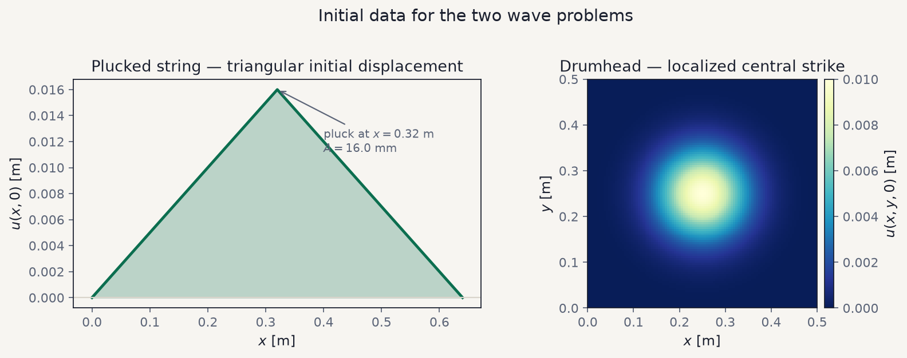
</p>

**Figure 1.** Left: the string is released from a triangular displacement
that peaks at mid-span — the classic guitar pluck. Right: the drumhead
starts from a smooth, centered bump that vanishes on the clamped rim.
Both fields begin at rest.

---

## Discretization and stability

An equispaced grid of spacing $\Delta x$ and time step $\Delta t$ defines
the Courant number

$$
r = \frac{c\,\Delta t}{\Delta x}.
$$

The leapfrog update in one dimension,

$$
u^{n+1}_i = 2(1-r^2)\,u^n_i - u^{n-1}_i + r^2\bigl(u^n_{i+1}+u^n_{i-1}\bigr)
$$

is stable for $r\le 1$. On the square membrane the five-point stencil
requires the stricter bound $r\le 1/\sqrt{2}$. Time steps are chosen from
a target Courant number so that both simulations sit safely inside their
stability region.

<p align="center">
  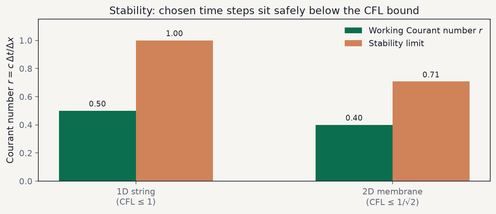
</p>

**Figure 2.** Working Courant numbers versus the analytic CFL limits.
The 1D run uses $r\approx 0.5$; the 2D run uses $r\approx 0.4$, below
$1/\sqrt{2}\approx 0.707$.

The first step from rest is taken with the standard centered starter so
that the scheme remains second-order in time from $t=0$. Details of the
stencils, energy formulae, and mode frequencies are collected in
[`docs/methodology.md`](docs/methodology.md).

---

## Fixed string: pluck, reflection, return

Released from the triangular pluck with both ends held fixed, the
displacement splits into left- and right-going waves. Each wave reflects
with a sign change at a Dirichlet end. After one fundamental period the
profile reforms — a direct numerical check of $T_1=2L/c$.

<p align="center">
  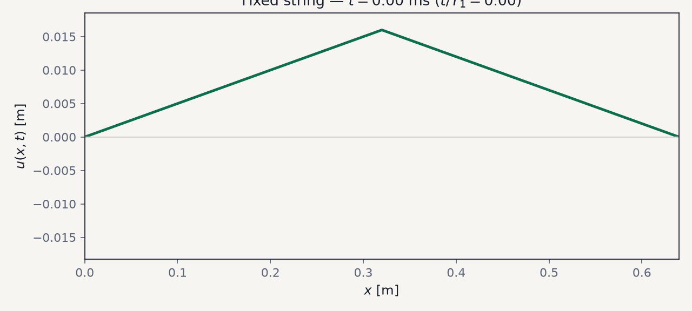
</p>

**Figure 3.** Temporal evolution of the fixed-end string over one
fundamental period. The pluck splits into counter-propagating pulses that
reflect with a sign change and reform the initial profile at $t=T_1$.

<p align="center">
  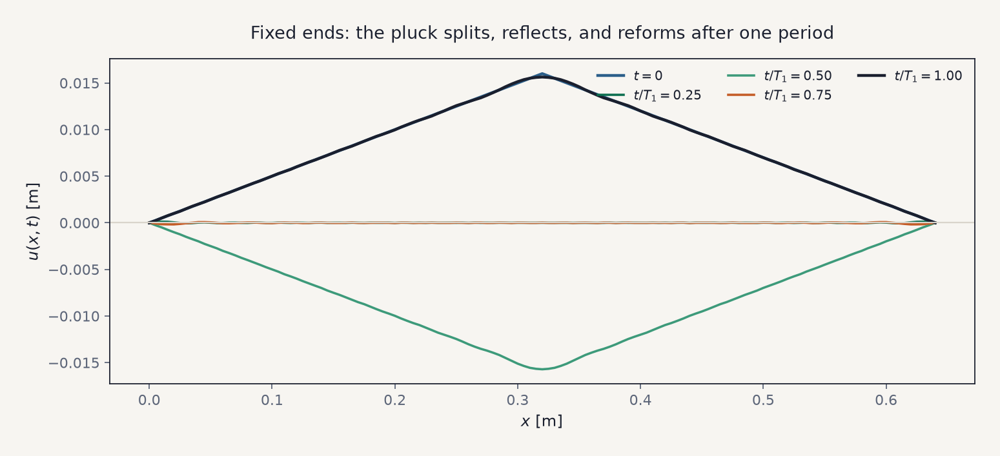
</p>

**Figure 3b.** Discrete snapshots of the same evolution at
$t/T_1\in\{0,0.25,0.5,0.75,1\}$.

<p align="center">
  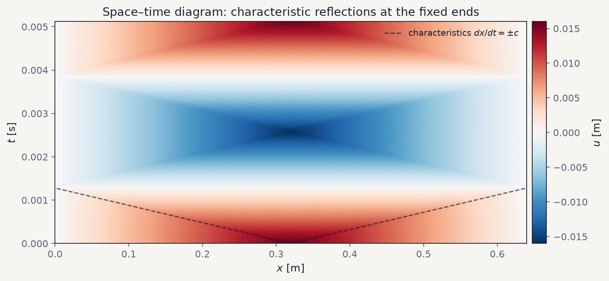
</p>

**Figure 4.** Space–time diagram of $u(x,t)$. The dashed lines mark the
characteristics $dx/dt=\pm c$. Reflections at $x=0$ and $x=L$ appear as
zig-zag ridges whose slope matches the prescribed wave speed.

Sampling the mid-point displacement yields an independent period
estimate from successive zero crossings, compared against the analytic
$T_1$:

<p align="center">
  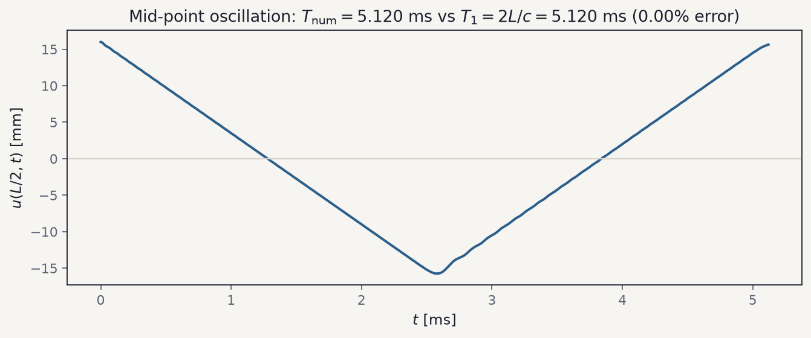
</p>

**Figure 5.** Mid-span time series. Field autocorrelation recovers
$T_{\mathrm{num}}=T_1=5.120\,\mathrm{ms}$ (0.00% error), confirming that
the discrete scheme propagates the fundamental at the correct speed.

For a closed system the discrete mechanical energy must stay nearly
constant. Monitoring

$$
E^n = \frac{1}{2}\sum_i (\partial_t^{\mathrm{stg}} u)^2\Delta x + \frac{c^2}{2}\sum_i (\partial_x u)^2\Delta x
$$

gives a sharp consistency diagnostic:

<p align="center">
  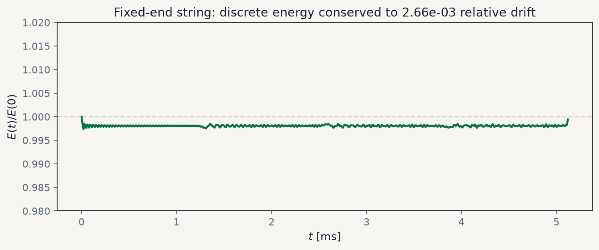
</p>

**Figure 6.** Relative discrete energy of the fixed-end string. Peak
relative drift is $\sim 3\times 10^{-3}$, as expected for a second-order,
non-dissipative scheme on a non-smooth initial pluck.

---

## Driven string: energy from the boundary

The same initial pluck is now evolved with the right endpoint prescribed
as a sinusoid at the fundamental frequency,

$$
u(L,t)=A\sin\Bigl(\frac{\pi c}{L}\,t\Bigr),
\qquad u(0,t)=0.
$$

The drive resonates with the lowest mode and continuously injects energy
into the string.

<p align="center">
  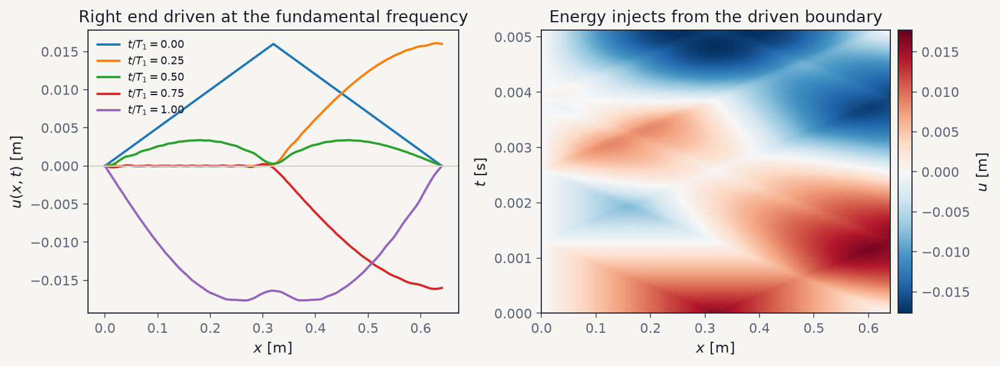
</p>

**Figure 7.** Left: spatial snapshots under resonant driving. Right:
space–time view showing waves that originate at the driven end and
propagate leftward. Unlike the fixed case, amplitude grows as the
boundary does work on the string.

---

## Clamped membrane: radial fronts and interference

On the square drumhead a centered strike launches an approximately
circular wavefront. The front expands, reflects from the clamped rim,
and folds back through itself, producing the interference pattern of a
rectangular membrane.

<p align="center">
  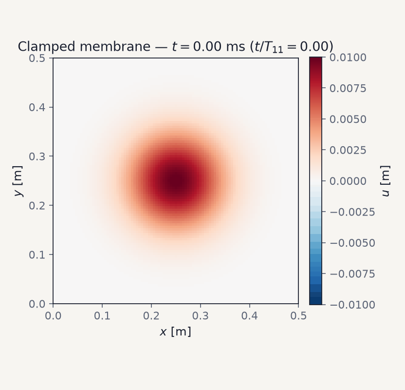
</p>

**Figure 8.** Temporal evolution of the clamped membrane over one
$(1,1)$-mode period $T_{11}$. A centered strike launches a circular front
that expands, reflects from the rim, and interferes with itself.

<p align="center">
  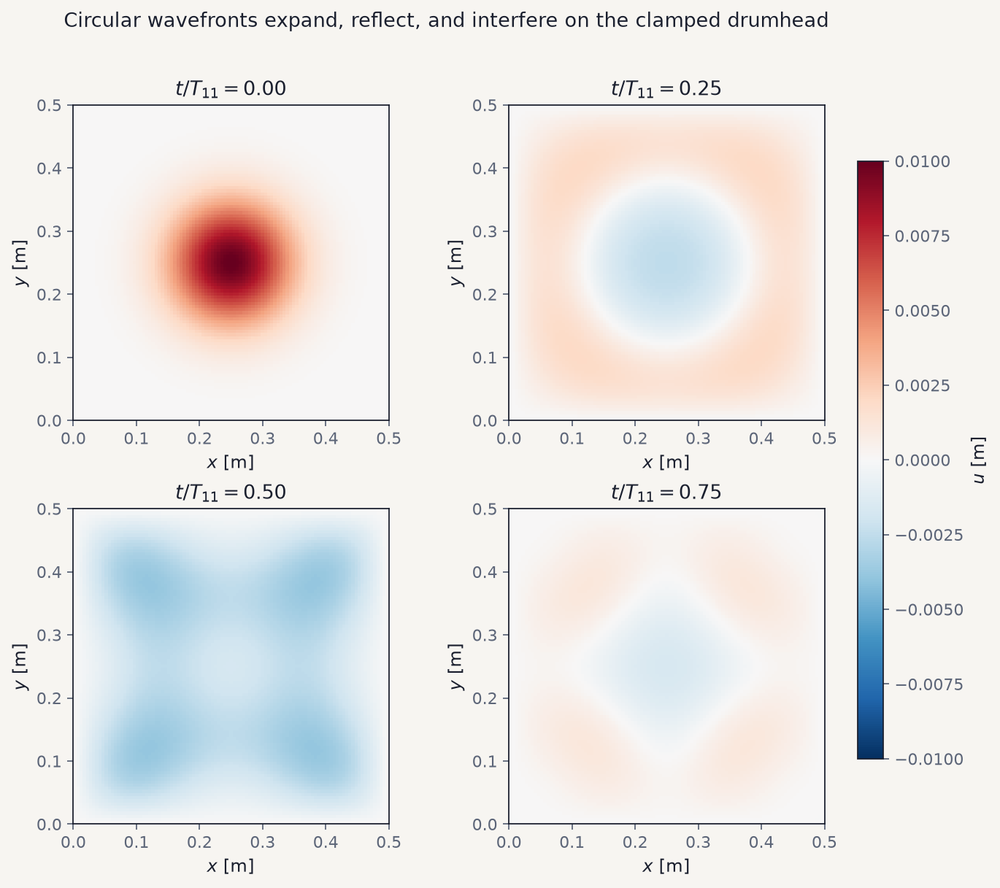
</p>

**Figure 8b.** Snapshots at $t/T_{11}\in\{0,0.25,0.5,0.75\}$ from the same
run.

<p align="center">
  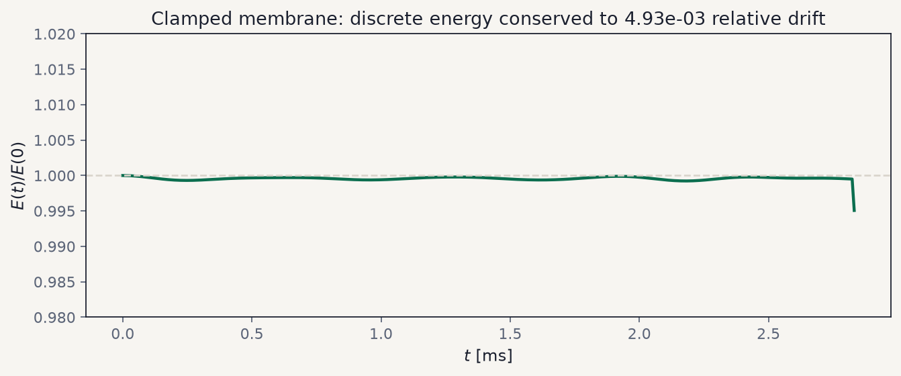
</p>

**Figure 9.** Discrete energy of the clamped membrane. With no external
drive the relative drift stays near $5\times 10^{-3}$, consistent with the
2D CFL-stable leapfrog scheme on a localized strike.

---

## Workflow close-out

Three time series summarize the narrative: the fixed string returns;
the driven string builds; the membrane center oscillates under
reflected fronts.

<p align="center">
  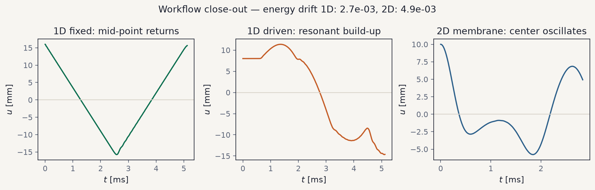
</p>

**Figure 10.** End-to-end diagnostics. Left: mid-point of the fixed
string recovers after $T_1$. Center: an interior probe on the driven
string shows resonant growth. Right: the membrane center oscillates as
energy cycles between kinetic and potential form.

---

## Repository layout

```text
wavefd/
  solvers/          # 1D and 2D leapfrog solvers
  analysis/         # CFL, energy drift, period estimates
  viz/              # figure suite used above
  io.py             # initial-condition loaders
data/               # string and membrane initial fields
scripts/run_pipeline.py
docs/methodology.md
figures/            # README figures (generated)
results/            # JSON summary and sparse snapshots
```

---

## Running the simulations

```bash
python -m pip install -r requirements.txt
make run
```

This integrates both systems, writes `results/summary.json`, and
regenerates every figure under `figures/`. Targeted checks:

```bash
python -m pip install pytest
python -m pytest -q tests
```

---

## Key references

- R. Courant, K. Friedrichs, H. Lewy, *Über die partiellen
  Differenzengleichungen der mathematischen Physik*, Math. Ann. (1928).
- J. C. Strikwerda, *Finite Difference Schemes and Partial Differential
  Equations*, SIAM.
- R. Haberman, *Applied Partial Differential Equations*, Pearson —
  separation of variables for strings and rectangular membranes.
